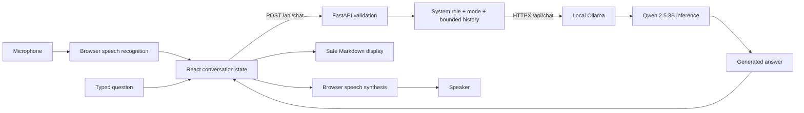

# VoxAI architecture

VoxAI is a local, single-user React/FastAPI application. It performs inference with an existing pretrained Qwen 2.5 3B model through Ollama; it does not train a model or use a paid AI API.



Recognition and synthesis are browser services, separate from Ollama. Recognition may send audio outside the laptop and require a network connection. Synthesis depends on the selected installed or online voice. Text chat needs no network service after installation when the default loopback settings are retained.

## Components and boundaries

| Layer | Responsibility | Files |
|---|---|---|
| React controller | Messages, successful history, request cancellation, health checks | `frontend/src/App.jsx` |
| Presentation | Header, orb, chat, Markdown, controls, settings | `frontend/src/components/` |
| Voice adapters | Actual Web Speech API event lifecycle and cleanup | `frontend/src/hooks/` |
| HTTP adapter | Relative `/api` fetch, readable errors | `frontend/src/services/api.js` |
| API | Lifespan HTTP client, local CORS, typed endpoints | `backend/main.py` |
| Contract | Validation and response schemas | `backend/schemas.py` |
| Inference adapter | Model discovery, error translation, history selection | `backend/ollama_client.py` |
| Prompt configuration | Role, factual constraints, three distinct styles | `backend/prompts.py` |

Vite proxies `/api` to `127.0.0.1:8000` for development and preview. FastAPI talks only to the configured Ollama base URL. The browser cannot change the upstream host or model through a chat request. All documented processes bind to loopback. CORS allows only the configured local frontend origins; CORS is not authentication. This is not a public multi-user deployment.

## API contract

`GET /api/health` checks Ollama `/api/tags` and verifies the configured model name. The JSON contains `backend`, `status`, `ollama_connected`, `model_available`, `model`, and an optional `error`. A healthy FastAPI service can return HTTP 200 with an offline/error body: consumers must check `status`. The frontend checks on mount, every 20 seconds, after a failed chat, and on Retry.

`POST /api/chat` accepts:

```json
{
  "message": "How is it different from an RNN?",
  "history": [
    {"role": "user", "content": "What is an LSTM?"},
    {"role": "assistant", "content": "An LSTM is a gated recurrent neural network."}
  ],
  "mode": "educational",
  "settings": {"temperature": 0.5, "max_tokens": 512}
}
```

Success contains `answer`, `model`, `status: "success"`, `elapsed_ms`, `context_messages`, and `truncated`. The truncated flag is derived from Ollama's completion reason. Errors use `detail`: validation 422; unavailable Ollama/model 503; timeout 504; unexpected upstream response 502. The 180-second upstream timeout allows model loading. The UI cancels after 190 seconds. Health uses a separate five-second upstream deadline.

## Memory and limits

The UI stores displayed messages in React state for the tab session. A separate in-memory reference contains only successful user/assistant pairs. Failed and canceled turns cannot contaminate context. It sends the most recent 12 messages. The API accepts at most 20 incoming history entries but independently keeps at most six complete pairs and 6,000 history characters, preserving chronological order. It drops unmatched assistant messages and incomplete turns. If a recent pair exceeds the remaining budget, older pairs are dropped as well to preserve a contiguous recent suffix.

The current question is limited to 4,000 characters. History entries accept up to 16,000 characters to accommodate generated code, before the stricter total selection. Unknown fields and caller-supplied system roles are rejected. Ollama receives `num_ctx: 8192`; character limits approximate size rather than performing exact Qwen tokenization. Languages and code can tokenize differently; extremely dense input can still exceed the useful model context. Clearing the conversation removes both visible messages and future context. Reloading also resets memory and settings. No database or persistent user transcript is implemented.

## Voice and concurrency

The mic starts only on user action. It first stops speech, uses non-continuous English recognition, displays interim results, stops when a final transcript arrives, and submits once on the end event. A 30-second watchdog and cancellation invalidate stale callbacks. Permission, audio device, silence, service, and network failures leave text input available. Unsupported browsers disable the mic.

Speech synthesis cancels existing speech before playback or replay, chooses an English voice, chunks long answers into short utterances, and replaces code blocks with an audible note. Canceling invalidates queued callbacks. The user can stop playback, turn off automatic voice, adjust speed, and choose a voice. Native recognition is never automatically restarted after speech, preventing a feedback loop.

One active chat request is allowed per tab, guarded synchronously by an AbortController reference. Clear/Cancel abort the browser request and discard late results. **Canceling the browser wait does not guarantee that Ollama immediately stops its inference**; allow the model to settle before starting another expensive request. The app does not claim a distributed cancellation protocol.

## State and security

Orb priority is listening → thinking → speaking → error → idle. These states derive from API or voice lifecycle, not a timer pretending to recognize speech. CSS animation is decorative, not an audio amplitude measurement. Reduced-motion preferences disable animation. Native dialog controls provide keyboard focus containment and Escape dismissal.

Generated code is displayed, never executed. Markdown is rendered without enabling raw HTML. Request data is validated; secrets and `.env` files are ignored. No telemetry, web search, retrieval, tools, account service, or cloud LLM integration is included. Local processes can still access loopback services. Do not expose the ports publicly without designing authentication, rate limits, transport security, and deployment controls.

References: [Ollama chat API](https://docs.ollama.com/api/chat), [FastAPI guide](https://fastapi.tiangolo.com/tutorial/), [Web Speech API](https://developer.mozilla.org/en-US/docs/Web/API/Web_Speech_API).
